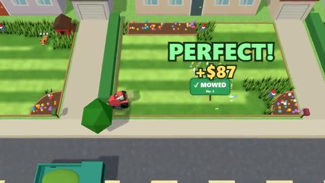

# Mow Crew

Mow the street's lawns in perfect stripes. A multiplayer starter game from [Multiplayer Agent](https://multiplayeragent.com): 3D, drop-in, 1–8 players, with bot crews that fill empty seats.

## How it plays

Ride over a yard with a price sign to cut it: straight rows leave neat light and dark stripes, and a yard pays once it's 95% cut, split by who mowed it (neat stripes pay a PERFECT bonus). Empty your bag at the truck or a compost bin, and mind the flower beds, the garden gnomes and the sleeping dog. Grass grows back, so the street always has work; each three-minute work day ends with a results card where you can spend your savings on a wider deck, a faster engine or a bigger bag.

**Controls:** WASD or arrow keys, or hold the mouse where to drive; on a phone, drag anywhere.

## Make it yours in the Game Builder

Open the [Game Builder](https://multiplayeragent.com), choose **Start from a starter game** and pick Mow Crew. It opens as version 1 in your studio, ready to play and publish. Then ask for changes, for example:

- Add a leaf blower power-up that clears a whole row at once
- Make it autumn, with leaves to rake instead of grass
- Add a rain shower that makes all the grass grow faster

## Run it yourself

1. Get a free publishable key (`pk_…`) at [multiplayeragent.com](https://multiplayeragent.com).
2. In `index.html`, put it in place of `pk_REPLACE_ME` in the `MP_CONNECT` block.
3. Serve the folder (for example `npx serve`) and open it. The 3D engine loads as a module, which browsers block from a file on disk.

Without a key it still runs, offline against bot crews.

## How it is built

- One `index.html` plus three.js in `libs/`. The comment at the top of the script maps the code and explains the multiplayer.
- **Leaderboard:** Each player's best day's cash.
- **Bots:** Bot crews pick yards and mow them in rows until enough people join.
- **Host-run rules:** The host's browser keeps every lawn's grass, pays the yards, runs the clock and the dogs; if it leaves, the next player takes over.
- **Host-run rounds:** Work days of three minutes with a results card between them.
- **Live sync:** Everyone sees the same stripes appear as anyone mows.
- **Saves:** Your savings and upgrades are kept for you between visits.
- **Live ops:** Raise every yard's price with no new deploy; an event's title shows on screen.
- `?attract` runs it offline with bots only. The preview video is recorded from it.

## License

MIT.
